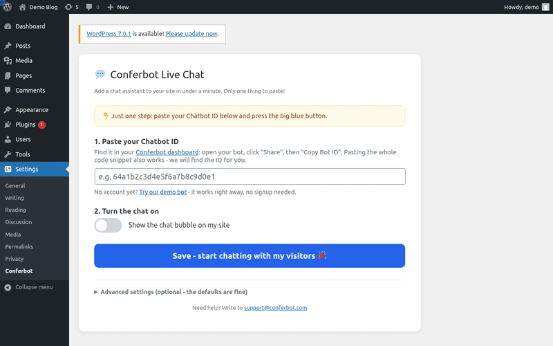

# Conferbot WordPress Plugin

Embeds the [Conferbot](https://conferbot.com) AI chat widget on a WordPress site or WooCommerce store. Same product as the [PrestaShop module](https://github.com/Conferbot/conferbot-prestashop) and [Shopify app](https://github.com/Conferbot/conferbot-shopify), WordPress-shaped.

## See it in action

Paste the Chatbot ID in Settings > Conferbot, save, and the chat is live:



[HD video (MP4)](docs/demo.mp4)

## How it works

The plugin hooks `wp_head` and injects the standard Conferbot loader. The widget script loads without blocking the page, and `ConferbotWidget` is called once it has loaded:

```html
<script>
  (function (d, s, id) {
    var js = d.createElement(s); js.async = true; js.id = id;
    js.src = "https://cdn.conferbot.com/dist/v1/widget.min.js";
    d.head.appendChild(js);
    js.onload = function () {
      window.ConferbotWidget("<CHATBOT_ID>", "live_chat", {
        user:       { id: "wp-7", name, email, hash },   // logged-in WP user, if any
        customData: { platform: "wordpress", siteName, siteUrl, siteLanguage,
                      storeCurrency?, cartTotal?, cartItemCount? }   // Woo, when active
      });
      // On the WooCommerce thank-you page, once per order:
      window.ConferbotWidget.track("purchase", { value, currency, order_id });
    };
  })(document, "script", "conferbot-js");
</script>
```

The only credential is the **Chatbot ID**. Paste the bare ID, the full embed code from the dashboard (your bot > Share > Embed), or a dashboard URL, and the ID is extracted automatically. A one-click **demo bot** works without an account.

Everything visitors see is set per bot in the Conferbot dashboard and delivered at runtime, with nothing to configure in WordPress: flows and AI agents, live chat with handover to your team (queue position, leave a message when nobody is free, read receipts, file sharing, post-chat rating), the home screen, themes and dark mode, colours, launcher and mascot, greetings and languages.

### Identity verification (optional)

With a secret from Conferbot (workspace settings > Security > Identity verification) pasted under Advanced settings, each logged-in customer is sent with `hash = HMAC-SHA256(secret, user.id)`, computed on your server. Conferbot then trusts their name and email, and can link their chats to their contact. The secret is stored in your WordPress options and never sent to the browser. Without it, the customer's details are still passed but marked unverified, and if your workspace *requires* verification they are dropped.

### Sales tracking

On the WooCommerce order-received page the plugin reports the order (`purchase`, with value, currency and order number) once per order, and every AJAX add-to-cart as `add_to_cart`. Conferbot credits a sale to a chat that happened within the week before it.

## Structure

```
conferbot.php                             # plugin bootstrap: hooks only
includes/
├── class-conferbot-bot-id.php            # ID extraction/validation + demo bot
├── class-conferbot-settings.php          # option shape, defaults, sanitize, persistence
├── class-conferbot-visibility.php        # conditional tags -> page type -> visible?
├── class-conferbot-context.php           # ConferbotWidget() options + script-safe JSON
└── class-conferbot-loader.php            # renders the loader; gathers live WP/Woo context
admin/class-conferbot-admin.php           # two-step settings page (nonce + capability checked)
uninstall.php                             # removes plugin options on delete
readme.txt                                # WordPress.org listing copy
tests/                                    # PHPUnit suite (WP functions stubbed)
```

## Tests

26 tests, no WordPress install needed:

```bash
docker run --rm -v "$PWD":/mod -v /path/to/phpunit-10.phar:/phpunit.phar:ro \
  -w /mod php:8.2-cli php /phpunit.phar
```

Covered: bot ID extraction (bare/snippet/URL/garbage), settings sanitization (invalid embed types, `javascript:` script URLs, enable-without-ID refusal, the write-only identity secret), WooCommerce-aware page-type resolution with priority rules, per-page visibility, guest/user/cart context building, the identity hash, purchase tracking once per order, and script-injection safety of the inlined JSON.

Verified end to end in a dockerized WordPress 7.1 with WooCommerce: activation, loader render with correct context, logged-in identity (`wp-1`), per-page gating on/off, and the real CDN widget mounting and chatting (see the video above).

## License

GPLv2 or later (WordPress.org requirement).
